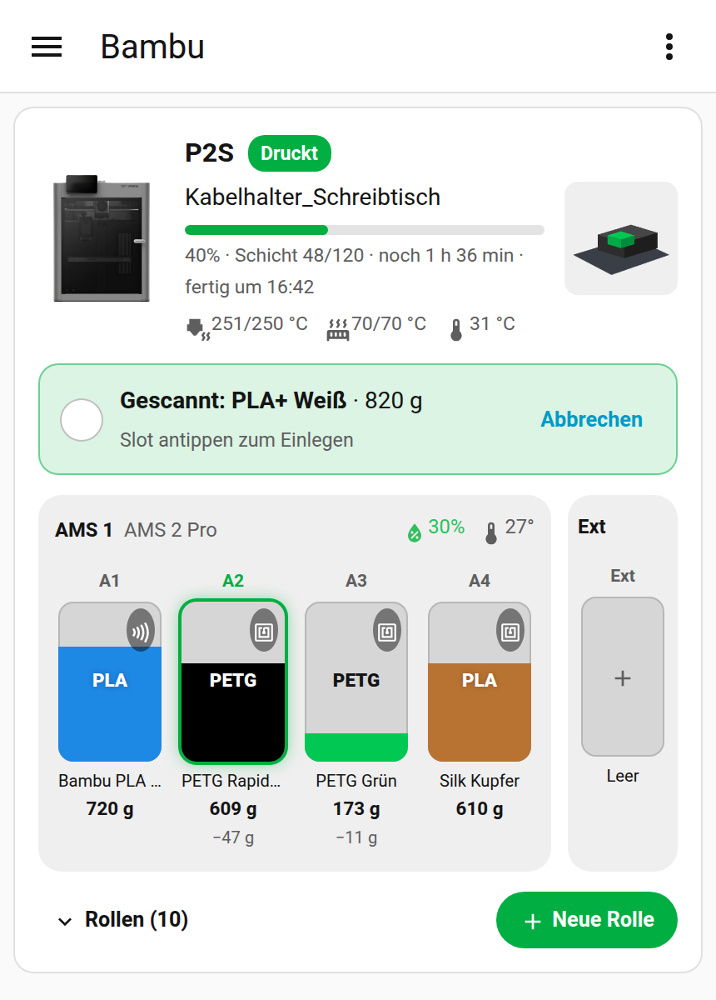
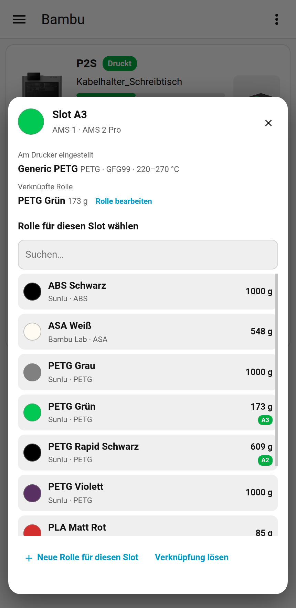
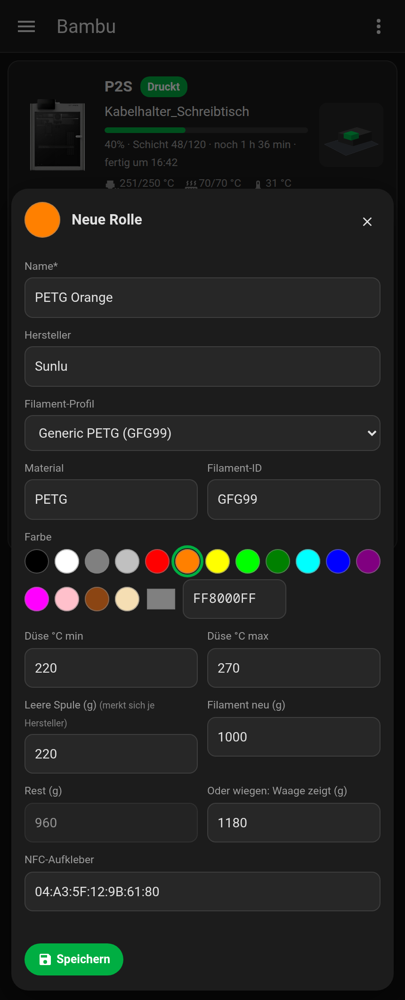
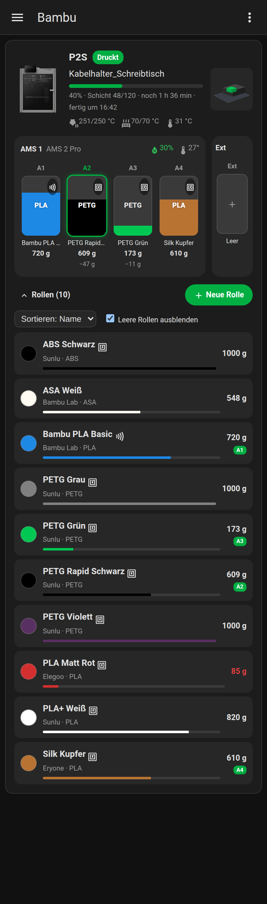
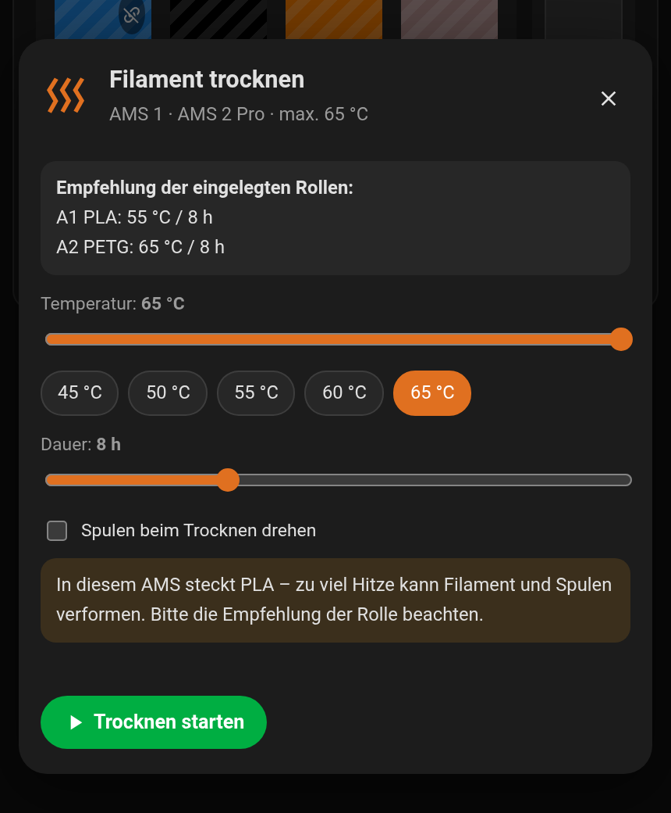
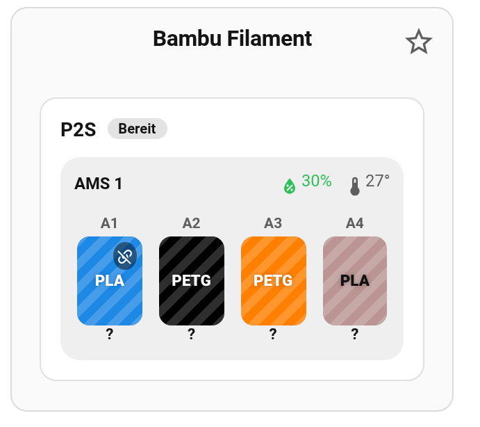

# Bambu Filament Manager

Spool inventory for Bambu Lab printers in Home Assistant – with an AMS card that looks like Bambu Studio, NFC stickers, live usage tracking and notifications.

One setup dialog for printer and filament – the printer connection runs through the [Bambu Lab integration (ha-bambulab)](https://github.com/greghesp/ha-bambulab) in the background. No helpers, scripts or automations needed.


<p align="center">
  
  
  
  
</p>
<p align="center">
  
  
</p>

## Features
- **AMS card like the original**: spools in their real colors with the remaining amount, active slot, humidity/temperature, external spool, AMS HT. Printer picture, cover image of the print, progress, layer, remaining time, temperatures, optional camera.
- **Spool inventory**: name, vendor, Bambu filament profile (catalog), color, nozzle temperatures, empty spool weight, remaining grams. Weighing: enter what the scale shows, the empty spool is subtracted.
- **Load into a slot** with one tap – profile, color and temperatures are sent to the AMS (LAN developer mode, see below).
- **NFC**: scan a sticker with the HA app → a message shows the spool (material, temperature, rest) with **slot buttons** in AMS order – tap “A2” and the spool is loaded, the same message confirms it.
  - HA app on Android: Android allows only 3 buttons, so each page shows 2 slots + “more ▸”; paging updates the same message without a new sound. iPhone: all slots at once.
  - Telegram: one button per slot with the full spool name and its rest; the slot the spool is already in is marked “✓”.
  - Tapping the message opens the card with the spool selected. Unknown sticker → the card offers to create a new spool with it.
- **AMS drying** (AMS 2 Pro up to 65 °C, AMS HT up to 85 °C): temperature, duration and spool rotation, with the recommendation of the loaded spools and a warning for PLA. While drying the card shows the remaining time and a stop button (LAN developer mode).
- **Live usage**: while printing, the grams are subtracted proportionally to the print progress. Cancelled prints only count the printed part. Survives restarts without double counting.
- **Warnings**: “not enough filament for this print” at print start, “almost empty” after the print.
- **Notifications** to any notification service set up in your HA (mobile app, Telegram, WhatsApp integrations, …), selectable in the options: usage after each print, “not enough filament”, “almost empty”, unknown NFC sticker. The scan message can go to its own targets (e.g. phone), everything else e.g. to Telegram. Phones and Telegram get buttons, all other services plain text.
- **Original Bambu spools (RFID)** are added automatically; the AMS reports their rest.
- Sensors per spool and per slot, events, and actions (`bambu_filament_manager.add_spool`, `assign_spool`, `weigh_spool`, …) for your own automations.


> [!IMPORTANT]
> **Everything is only available in local LAN mode with developer mode enabled.**
> Current Bambu firmware only accepts commands from Home Assistant in developer mode. Without it (and always via the Bambu Cloud) the Filament Manager can **read** everything – slots, colors, progress, usage, warnings – but it cannot **send** color, filament profile and temperatures to the AMS. Spools are then only linked to the slot, and you set color/profile on the printer or in Bambu Handy. The card shows a note when this applies.

## Installation
1. Marketplace (or HACS) → ⋮ → Custom repositories → add `Trunks1982/ha-bambu-filament-manager` (type *Integration*) → download → restart Home Assistant.
2. Settings → Devices & services → Add integration → **Bambu Filament Manager**.
3. Choose how the printer is connected – **local (LAN)** with IP address, serial number and access code, or **Bambu Cloud** with your Bambu account (email, password, code from the Bambu email). The printer connection itself is set up in the background in the [Bambu Lab integration (ha-bambulab)](https://github.com/greghesp/ha-bambulab), so it keeps getting their updates for new printers and firmware. If ha-bambulab is not installed yet, the dialog links to it.
   Already have a printer in ha-bambulab? Then it is found automatically – nothing to enter.
4. More printers: integration → *Configure* → *Add printer*.

Filament usage per print needs the 3MF to be readable by ha-bambulab (on printers without SD card: USB stick and “store sent files on external storage” in Bambu Studio).

Add the card in the dashboard: *Add card → By card → Community cards →* **“Bambu Filament”** (with live preview) or `type: custom:bambu-filament-card`. It is loaded automatically – no resource needed.

**Options** (integration → *Configure*):
- *Settings*: notification targets, scan message targets, which messages, “almost empty” threshold, default empty spool weight and filament amount, add original Bambu spools automatically, NFC stickers to ignore.
- *Add printer – local (LAN)* or *Add printer – Bambu Cloud*.

```yaml
type: custom:bambu-filament-card
printer: <device id>   # optional, first printer by default
show_camera: false
show_spools: true
```
<br><br>
"Ein Kaffee für nächste lange Nacht vor dem Rechner wäre toll" ist aber natürlich kein muss.
<br>[](https://www.paypal.com/donate/?hosted_button_id=H94LZRQW9PFQ4)
